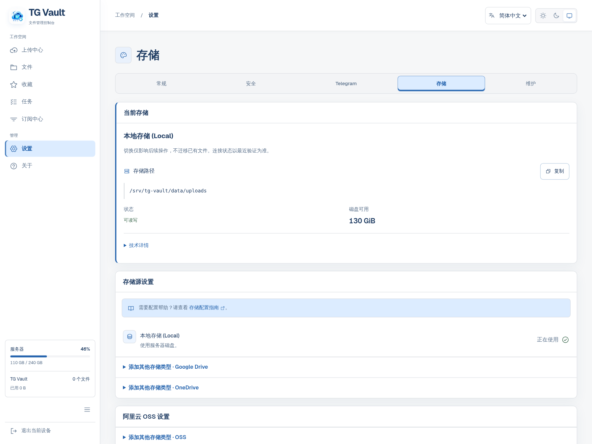
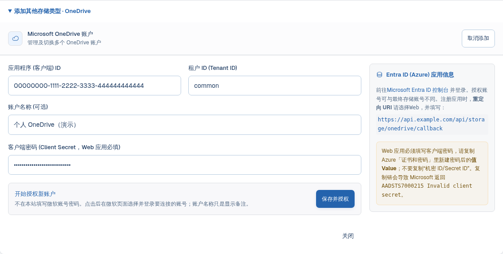
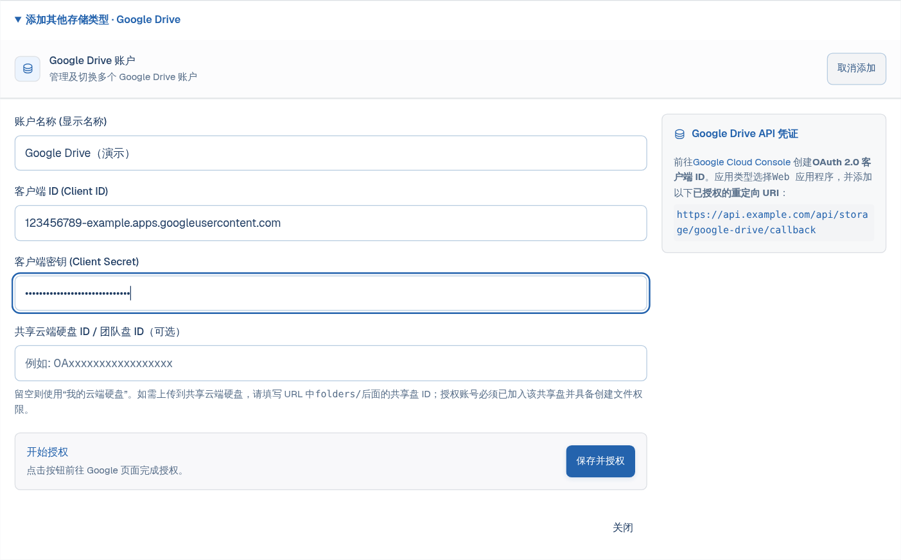
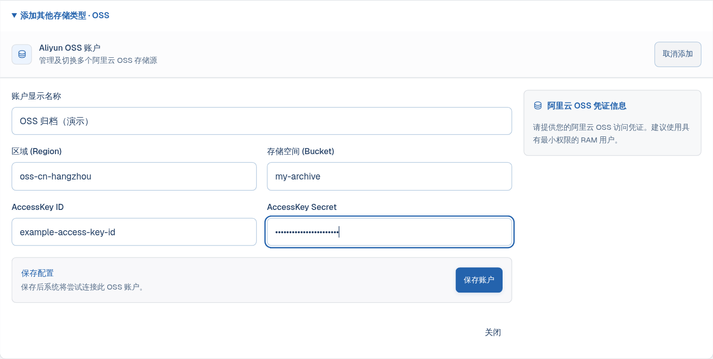
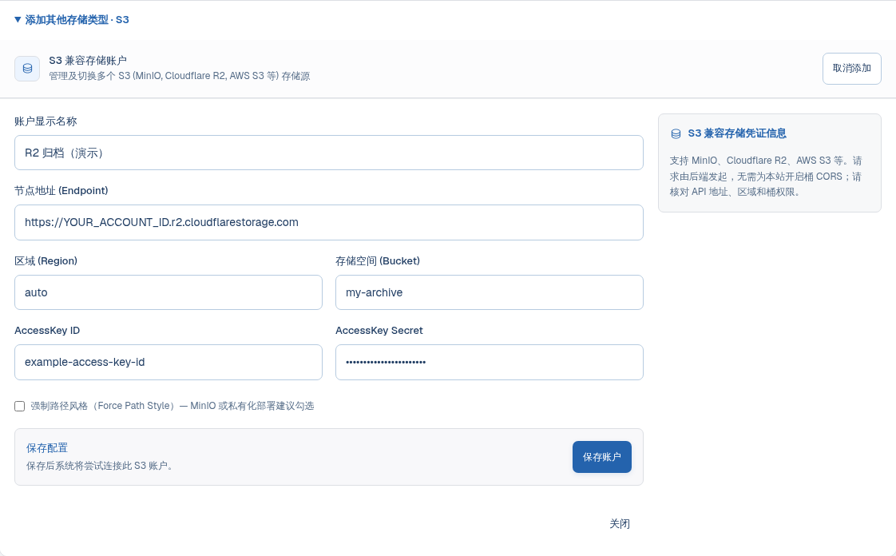
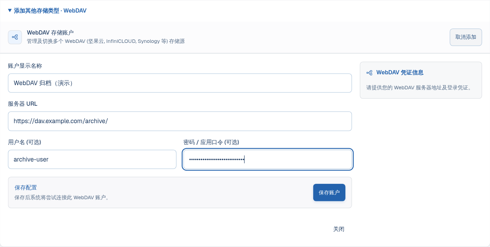
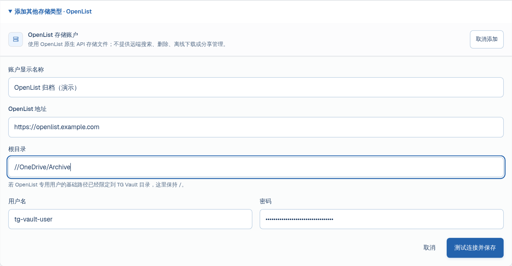



# 存储源配置

第一次使用，建议先用**本地存储上传一个小文件**，确认部署正常，再添加云存储。本页按 TG Vault 实际表单讲解，不需要先学会 OpenList。

<div class="callout" markdown="1">
**OneDrive 不填微软账号密码，能连接吗？能，但不是免登录。**
TG Vault 先收集应用的 Client ID 和 Client Secret；点击“保存并授权”后，你在**微软官方页面**选择账号、登录并同意权限。TG Vault 保存授权令牌，之后用令牌访问网盘。“账户名称”只是备注，不是登录账号。
</div>

## 本页导航

- [先选存储，再准备材料](#choose)
- [添加与验证的共同步骤](#start)
- [本地磁盘](#local)
- [OneDrive：微软网页授权](#onedrive)
- [Google Drive：谷歌网页授权](#google-drive)
- [阿里云 OSS](#oss)
- [S3：AWS、R2、B2、MinIO](#s3)
- [WebDAV：坚果云、NAS、自建服务](#webdav)
- [OpenList：连接已经挂载好的目录](#openlist)
- [报错排查与配置边界](#troubleshooting)
- [参考资料](#references)

<a id="choose"></a>
## 先选存储，再准备材料

| 你已有的资源 | 选择 | 添加前准备 |
| --- | --- | --- |
| 服务器硬盘 | 本地磁盘 | 确认宿主机保存位置、剩余空间与写入权限 |
| 国际版微软个人、工作或学校网盘 | OneDrive | Microsoft 应用 Client ID、Secret、回调地址；随后网页登录云盘账号 |
| Google 账号与云端硬盘 | Google Drive | 启用 Drive API，创建 Web OAuth 客户端及 Secret；随后网页登录 |
| 阿里云对象存储 | 阿里云 OSS | Bucket、Region、RAM AccessKey ID / Secret |
| AWS S3、Cloudflare R2、B2 或 MinIO | S3 兼容存储 | HTTPS API Endpoint、Region、Bucket、S3 访问密钥 |
| 服务商或 NAS 提供的 DAV 接口 | WebDAV | WebDAV 入口、用户名、应用口令；匿名服务才可不填凭据 |
| 已经运行并挂载好云盘的 OpenList | OpenList | 站点地址、可写目录、OpenList 专用用户名和密码 |

**注意：阿里云 OSS ≠ 阿里云盘；Google Drive ≠ Google Cloud Storage；R2 的 S3 密钥 ≠ Cloudflare 登录密码。**

TG Vault 是文件转存与归档工具，不是把云盘全部目录直接展示出来的通用挂载管理器。添加账户不会自动扫描、导入远端已有文件。不要把 OpenList 的“挂载路径”、第三方 Token 工具地址或其他驱动参数原样搬进来。

<a id="start"></a>
## 添加与验证的共同步骤

1. 登录 TG Vault，打开 **设置 → 存储源**。展开要使用的存储类型，点击 **添加账户**。不同宽度或语言下按钮文字可能略有差别。
2. 按对应章节准备材料并填写；**名称是你自己起的备注**，例如“个人 OneDrive”或“R2 归档桶”。示例域名和密钥不能直接使用。
3. OneDrive / Google Drive 点击 **保存并授权**，允许弹窗，在提供商页面登录。其他远端存储点击 **保存账户**。
4. 添加流程会执行相应的连接检查；账户卡片上也可手动**测试连接**。OAuth 成功后会自动启用新账户；OSS / S3 / WebDAV / OpenList 添加后需自行切换。
5. 核对“正在使用”的账户，再上传一个无敏感内容的小文件，到提供商网页确认位置，并下载打开核对内容。连接测试成功不等于上传、下载、删除权限都已验证。

<figure>
  <a href="assets/images/storage/storage-entry.png"></a>
  <figcaption>图 1：从设置进入存储源。项目界面截图，使用隔离的演示数据；不包含真实账号或凭据。点击图片可放大。</figcaption>
</figure>

<div class="callout warning" markdown="1">
**切换默认存储不等于迁移文件。**系统默认值只影响后续新任务；已提交、排队或执行中的任务保留原目标。Telegram 可通过 `/target` 指定聊天目标，提交任务前仍应核对保存账户和目录。备份本地数据也不会备份云端实体文件。
</div>

<a id="local"></a>
## 本地磁盘

**不需要账号、密码或 API 密钥。**本地存储由部署时的 Docker 挂载决定，不是在 Web 表单里随意填写服务器路径。

1. 在存储源页查看 **服务器保存位置**、可用空间和可写状态。
2. 展开详情，区分“宿主机路径”和“容器内路径”；容器通常使用 `/data/uploads`，以当前部署显示为准。
3. 选择本地存储，上传一个小文件，确认宿主机对应位置确实存在文件。

安装方式可能使用绑定目录，也可能使用 Docker 卷；**不要假定所有部署都使用名为 `file-storage` 的卷**。位置显示“未确认”时，应先核对挂载，不能根据容器路径猜宿主机位置。迁移需要备份数据库、部署配置和完整持久数据，包含内部密钥及 Telegram 会话。参见[部署与数据目录](quick-start.html)和[运维与备份](operations.html)。

不要手工向受管理的上传目录塞入未登记文件；孤儿文件清理可能删除它们。

<a id="onedrive"></a>
## OneDrive：微软网页授权

### 先分清三种“账号 / 密码”

| 名称 | 是什么 | 填在哪里 |
| --- | --- | --- |
| 微软账号和登录密码 | 你用于登录 OneDrive 的邮箱、密码及双重验证 | 只在微软登录页填写 |
| Client ID / Client Secret | 允许 TG Vault 请求授权的应用凭据；不是网盘账号密码 | TG Vault 的 OneDrive 表单 |
| 账户名称 | 便于区分存储的显示备注 | TG Vault 表单，可选 |

### 第 1 步：复制自己的回调地址

打开 TG Vault 的 OneDrive 添加表单，复制应用信息说明中显示的 **重定向 URI**（宽屏通常在表单右侧，小屏可能上下排列）。例如：

```text
https://api.example.com/api/storage/onedrive/callback
```

这里的 `api.example.com` 必须换成你的实际后端域名。**以设置页显示值为准**，不要填写前端首页，也不要使用 OpenList 教程里的 `api.oplist.org` 回调地址。

### 第 2 步：注册 Microsoft 应用

1. 打开 [Microsoft Entra 管理中心](https://entra.microsoft.com/)，进入 **标识 → 应用程序 → 应用注册 → 新注册**。控制台菜单可能调整，可搜索“应用注册”。
2. 名称可填“TG Vault 自用”。支持的账户类型按实际账号选：个人微软账号需选择包含**个人 Microsoft 账户**的选项；需要多个组织和个人账号时，选“任何组织目录中的账户和个人 Microsoft 账户”。仅组织内使用才选单租户。
3. 重定向 URI 平台选择 **Web**，粘贴第 1 步复制的地址，点击注册。**不是 SPA，也不是移动和桌面应用。**
4. 在概述页复制 **应用程序（客户端）ID / Application (client) ID**。不要复制“对象 ID”。
5. 进入 **证书和密码 → 客户端密码 → 新客户端密码**，设置有效期，创建后立即复制 **值 / Value**。**Secret ID / 机密 ID 不是密码**。Value 只在创建时显示，离开页面后无法重新查看；遗失后重新创建。
6. 在 **API 权限 → 添加权限 → Microsoft Graph → 委托的权限** 中确认文件读写权限。项目授权请求使用 `Files.ReadWrite.All` 和 `offline_access`；只给 `Files.Read` 无法满足转存写入。组织禁止用户同意时，需要管理员批准，不要关闭组织安全策略绕过审批。

<figure>
  
  <figcaption>图 2：微软控制台操作路线示意，不是控制台截图。重点是 Web 类型、本站回调和 Secret 的 Value。</figcaption>
</figure>

### 第 3 步：逐项填写 TG Vault

| 表单字段 | 怎么填 |
| --- | --- |
| 应用程序（客户端）ID | 概述页的 Application (client) ID |
| 租户 ID | 通常保持 `common`，前提是应用账户类型允许该账号；单租户应用填该组织的 Directory (tenant) ID；高级用法可按微软文档使用 `consumers` 或 `organizations` |
| 账户名称 | 可选，建议填“个人网盘”等便于识别的备注，不用于登录 |
| 客户端密码（Client Secret） | 第 2 步创建的 **Value**。本文采用后端兑换令牌的 **Web 应用流程，必填** |

旧页面如果仍写“Client Secret 可选 / 公共客户端可不填”，不要在按本教程注册 Web 应用后留空。Web 应用需要客户端凭据；“公共客户端”是另一种应用类型，不是省略密码的快捷选项。

<figure>
  <a href="assets/images/storage/onedrive-form.png"></a>
  <figcaption>图 3：OneDrive 参数与项目表单对应。所有值仅为示例；微软账号在下一步的官方页面选择。</figcaption>
</figure>

### 第 4 步：登录真正要连接的网盘账号

点击 **保存并授权** → 允许浏览器弹窗 → 在微软页面选择或输入要连接的账号 → 完成密码 / MFA → 同意授权 → 等待返回。**应用注册所用账号不必就是网盘账号**，但应用支持的账号类型、租户和组织策略必须允许这个账号登录。

授权成功后，TG Vault 自动保存令牌并启用该账户；不需要手工抓取 Refresh Token。再到 OneDrive 网页核对试传文件。需要多个网盘时分别完成授权，名称写清楚，不要仅凭默认账户名判断实际连接的是谁。

### 与 OpenList 教程的区别

OpenList 可使用在线 API 默认应用、手填刷新令牌，还包含世纪互联、SharePoint、APP 等不同驱动。**TG Vault 直连这里只实现国际版登录端点和当前用户的 OneDrive**；没有版本选择、SharePoint site ID、应用权限模式或默认公共应用选项。不要导入 OpenList 默认应用签发的令牌当作本项目自建应用的令牌。其他驱动需求可先在 OpenList 挂载，再按本页 [OpenList 章节](#openlist)连接可写目录。

<a id="google-drive"></a>
## Google Drive：谷歌网页授权

### 第 1 步：在 Google Cloud 准备应用

1. 打开 [Google Cloud Console](https://console.cloud.google.com/)，创建或选择自己的项目。
2. 在 **API 和服务 → 库** 中搜索 **Google Drive API** 并启用。
3. 打开 **Google Auth Platform**，依次配置应用品牌信息、受众与联系邮箱。个人 / 外部账号通常选择 External；组织内部应用只适用于对应 Workspace 组织。
4. 处于 Testing 时，在测试用户里添加**将要登录的 Google 邮箱**。访问未验证应用的提示只应在确认是自己创建的应用后继续。
5. 在客户端页面创建 **Web application / Web 应用** OAuth 客户端。把 TG Vault Google Drive 表单显示的回调填入 **Authorized redirect URIs / 已获授权的重定向 URI**，不是“JavaScript 来源”。例如：

```text
https://api.example.com/api/storage/google-drive/callback
```

6. 保存后复制 Client ID 和 Client Secret。不要使用 API Key 替代 OAuth 凭据，不需要上传服务账号 JSON。

### 第 2 步：填写并授权

| 表单字段 | 怎么填 |
| --- | --- |
| 账户名称 | 显示备注，可选 |
| Client ID / Client Secret | 刚创建的 Web OAuth 客户端的一对凭据，均必填 |
| 共享云端硬盘 ID | 普通“我的云端硬盘”留空；仅使用 Shared drive 时填写该共享盘 ID，不是普通文件夹链接 |

点击 **保存并授权**，在 Google 页面登录目标账号并允许请求的文件访问权限。共享盘用户必须能在该盘创建文件，且文件需在应用授权可访问范围内。项目请求 `drive.file`，并非扫描所有既有文件的全盘权限；不要把“连接成功”理解为自动导入整个 Drive。

<figure>
  <a href="assets/images/storage/google-drive-form.png"></a>
  <figcaption>图 4：普通个人云盘不填共享盘 ID；Client ID 和 Secret 来自同一个 Web OAuth 客户端。</figcaption>
</figure>

授权成功后自动启用账户。项目在目标位置使用 `TG Vault` 文件夹；上传后到 Google Drive 网页确认。External 应用仍处于 Testing 且申请 Drive 权限时，刷新令牌通常在 **7 天**后到期，不适合长期无人值守归档；正式使用需了解 Google 的发布与验证要求。应用发布不等于必然通过验证或消除所有授权限制。

<a id="oss"></a>
## 阿里云 OSS

**这是按用量计费的对象存储，不是“阿里云盘”。**先了解容量、请求和外网流量费用；私有桶不必为了连接 TG Vault 改成公共读写。

1. 在 [OSS 控制台](https://oss.console.aliyun.com/)创建或选择 Bucket，记录桶名称和地域。
2. 在 RAM 创建专用用户及 AccessKey，只授权目标桶所需的列举、读取、写入和删除对象权限。连接测试会列举对象；只有写权限可能测试失败。不要直接使用主账号 AccessKey。
3. 在 TG Vault 选择 **Aliyun OSS**，按表填写后保存。

| 字段 | 填写示例与来源 |
| --- | --- |
| 账户显示名称 | 自己起名，例如“OSS 归档” |
| Region | 从桶概览获取，例如 `oss-cn-hangzhou`；推荐填地域标识，不填带桶名的 URL |
| Bucket | 只填桶名，例如 `my-archive`，不加 `https://`、路径或地域后缀 |
| AccessKey ID | RAM 用户的 AccessKey ID |
| AccessKey Secret | 同一对密钥的 Secret，不是阿里云账号密码 |

<figure>
  <a href="assets/images/storage/oss-form.png"></a>
  <figcaption>OSS 参数位置：地域与桶名分开填，密钥来自同一 RAM 用户，不是阿里云盘凭据。</figcaption>
</figure>

保存后核对连接状态，再切换为默认账户并试传文件。当前表单没有 STS SecurityToken、独立 Endpoint 或自定义 CDN 字段，不能只把临时凭证的两段填入并省略第三段令牌。

<a id="s3"></a>
## S3：AWS、R2、B2、MinIO

S3 是接口协议；不同服务商的 Endpoint、Region 和密钥不通用。先在服务商处创建桶和**可访问该桶的 S3 读写凭据**。所有输入以自己控制台为准。

| TG Vault 字段 | 怎么填 |
| --- | --- |
| 账户显示名称 | 例如“R2 归档” |
| Endpoint | 完整的 HTTPS **S3 API 地址**；不是控制台、公开下载域名或某个文件链接 |
| Region | 必填，按提供商要求；R2 填 `auto`，不要把它套到 AWS / B2 |
| Bucket | 已创建的桶名，与 Endpoint 分开填 |
| AccessKey ID / AccessKey Secret | 同一对 S3 API 密钥；不是网站登录信息 |
| Force Path Style | 是否使用 `endpoint/bucket/object`。MinIO 常需要勾选，其他服务按文档选择 |

请求由 TG Vault 后端向 S3 发起，不是浏览器直传，**无需为了本站开启桶 CORS**。旧界面如仍要求开启跨域，不要据此设置宽泛的 `*` 规则。

<figure>
  <a href="assets/images/storage/s3-form.png"></a>
  <figcaption>图 5：以 R2 说明字段位置，账号 ID、桶名与密钥均需换成你自己的值。</figcaption>
</figure>

### Cloudflare R2 示例

1. 打开 Cloudflare **R2 Object Storage**，创建或选择桶。
2. 创建允许目标桶对象读写的 R2 API 凭据，保存 **Access Key ID** 和 **Secret Access Key**。**不要把 Cloudflare 通用 API Token 填到 Secret 字段。**
3. 复制控制台提供的 S3 API Endpoint，通常形如 `https://<ACCOUNT_ID>.r2.cloudflarestorage.com`；特殊管辖区域使用控制台提供的对应地址。桶名另填，Region 填 `auto`。
4. 保存、测试、切换，再上传小文件。不要用 `r2.dev` 公开域名替代 S3 API Endpoint。

### 其他服务怎么找参数

| 服务 | Endpoint / Region 来源 | 注意 |
| --- | --- | --- |
| AWS S3 | 桶所在区域的 S3 API Endpoint 与实际 Region | 不要默认所有桶都是 `us-east-1` |
| Backblaze B2 | 桶页面的 S3 Endpoint 及对应 Region | 使用兼容 S3 的 Application Key，保留列举及对象读写所需权限 |
| MinIO | 管理员提供的 S3 API 地址和 Region | 不要填写管理控制台端口；通常勾选 path-style；未配置特殊 Region 时向管理员确认 |

当前表单只接收 AccessKey ID + Secret，**不支持需要 SessionToken 的三段式临时 STS 凭据**。默认要求公网 HTTPS 地址；**WebDAV 的内网开关不适用于 S3**。局域网 MinIO 不要靠开启 WebDAV 开关解决；应使用受信任且项目可访问的 HTTPS 接入方案，或经已经配置好的 OpenList 接入。不要修改全局安全策略来试错。

<a id="webdav"></a>
## WebDAV：坚果云、NAS、自建服务

### 第 1 步：在提供商开启 WebDAV

获取服务商明确提供的 **WebDAV 地址**、用户名和密码 / 应用口令。普通网页首页、网盘分享链接和管理后台地址都不一定是 DAV 入口。坚果云通常需要在安全设置里生成第三方应用密码；Nextcloud 等服务可从自己的客户端设置复制 DAV URL。

### 第 2 步：填到 TG Vault

| 字段 | 怎么填 |
| --- | --- |
| 账户显示名称 | 例如“NAS 归档” |
| 服务器 URL | 完整 DAV 根地址；指定子目录时把目录路径包含在 URL 中 |
| 用户名 | 服务商要求的登录名；可能是邮箱或独立 DAV 用户 |
| 密码 / 应用口令 | 提供商生成的 DAV / 应用密码；不要默认使用网页登录密码 |

界面标“用户名 / 密码可选”只代表程序允许匿名 WebDAV，**不代表服务商不需要认证**。有认证的服务必须填写；如果文件夹只读，能列目录也不能用于归档。

<figure>
  <a href="assets/images/storage/webdav-form.png"></a>
  <figcaption>图 6：“可选”只适用于远端确实允许匿名访问的场景；普通 NAS / 网盘仍需凭据。</figcaption>
</figure>

### 飞牛、群晖等局域网 NAS

默认安全策略拒绝 HTTP、回环、私有网段与保留地址。确实只连接可信局域网 WebDAV 时，可到 **设置 → 安全 → 网络与存储安全**，阅读并确认 **允许内网和不安全的 WebDAV 地址**。这会扩大服务器可访问范围并允许明文传输，有 SSRF 风险；不是通用“修复连接”开关。

- 地址必须从 **backend 容器**能连通；容器内 `127.0.0.1` 指容器自身，不是宿主机。
- NAS 必须监听容器可达的地址，且防火墙、端口与路由允许连接。
- 该开关不会忽略 HTTPS 证书错误；自签证书需要正确配置受信任的证书链，不要照搬 OpenList 的“跳过 SSL 验证”。
- 大文件长期无响应可检查 `WEBDAV_INACTIVITY_TIMEOUT_MS` 和 `WEBDAV_UPLOAD_TIMEOUT_MS`，先排除权限、配额和代理限制，不要盲目增加超时。

<a id="openlist"></a>
## OpenList：连接已经挂载好的目录

**这不是在 TG Vault 里管理 OpenList 驱动。**你先在 OpenList 挂载好网盘并确认目录可写，TG Vault 再通过 OpenList 原生 API 向该目录转存文件。

1. 在 OpenList 后台完成真正的存储挂载。使用该 OpenList 账号，从 OpenList 网页向目标目录上传一个小文件，确认可读写。
2. 为 TG Vault 准备专用 OpenList 用户，设置对应目录访问及上传、读取、删除等需要的权限。不要为了方便共享管理员密码。
3. 回到 TG Vault 的 **OpenList** 类型，填写下表并保存。添加时会做实际写入检查，不应使用只读目录。

| 字段 | 怎么填 |
| --- | --- |
| 账户显示名称 | 例如“OpenList 归档目录” |
| 服务地址 | OpenList 站点根地址，例如 `https://openlist.example.com`；若反代部署于子路径需包含实际前缀，不追加 `/api/fs`、`/dav` 或文件分享路径 |
| 根目录 | OpenList 虚拟目录，例如 `/OneDrive/Archive`；默认 `/`，不是服务器 `/data`，也不是网盘分享链接 |
| 用户名 / 密码 | **OpenList 用户**的登录凭据，均需填写；不是其背后微软 / 阿里云账号密码 |

<figure>
  <a href="assets/images/storage/openlist-form.png"></a>
  <figcaption>图 7：站点地址与目录分开填写。示例目录必须先在自己的 OpenList 中存在且可写。</figcaption>
</figure>

项目自动登录换取 Token，当前没有游客、手填 Token、两步验证代码或元信息密码字段。OpenList 自己的“挂载其他 OpenList”教程可能提供这些选项，**不代表 TG Vault 表单同样支持**。目录需要元信息密码或账号要求交互式二次验证时，不要盲填密码或关闭账号安全，先选择适配当前接口的专用账户 / 目录。

原生 OpenList 接入默认要求公网 HTTPS；**WebDAV 内网开关不放宽此处限制**。如果只提供内网 WebDAV，可明确选择 TG Vault 的 WebDAV 类型并按其章节配置，而不是把 `/dav` 填入 OpenList 服务地址。

<a id="troubleshooting"></a>
## 报错排查与配置边界

### 先看成功标准

账户卡片出现 → 测试连接成功 → 核对默认目标 → 小文件上传成功 → 提供商网页可见 → 下载内容正确。删除测试只针对自己刚上传的测试文件，不要拿已有归档试权限。OpenList 添加会做写入检查；其他提供商的探测通常只是读 / 列目录，不是完整读写保证。

| 现象 | 优先检查 |
| --- | --- |
| OneDrive 没有账号输入框 | 正常；点击授权后在微软页面选账号，账户名称只是备注 |
| `AADSTS7000218` / 要求 `client_secret` | Web 应用缺少 Secret；填写证书和密码中的 Value，不要把它当作可选项 |
| `AADSTS7000215` | Secret 无效、复制了 Secret ID，或密钥属于另一应用；在同一应用下创建新的 Secret |
| `AADSTS7000222` / Secret 到期 | 更新应用 Secret 并重新添加授权；不要把微软登录密码填进来 |
| `AADSTS50011` / `redirect_uri_mismatch` | 提供商登记回调必须与 TG Vault 设置页逐字一致，包括协议、域名、路径、尾斜杠 |
| OneDrive 提示账号不在租户 / 个人账号不支持 | 检查应用支持的账号类型和租户；个人账号不能套单租户组织配置 |
| Google `403: access_denied` | 检查登录账号、Testing 测试用户、组织策略及同意权限，不是反复换 Secret |
| Google 授权几天后失效 | 检查 External + Testing 的 7 天刷新令牌限制、用户撤销权限及应用发布状态 |
| 授权弹窗被拦截 | 只对自己的站点允许弹窗，再重新点击授权；不要在另一个浏览器 / 无登录会话里打开回调 |
| 回调成功但原页面还在等待 | 检查 Web/API HTTPS、Cookie、前后端 origin 与 `OAUTH_FRONTEND_ORIGIN`；跨站 Cookie 并非仅加 CORS 就能解决 |
| S3 `SignatureDoesNotMatch` | 核对密钥配对、Region、API Endpoint、path-style 和服务器时钟 |
| OSS / S3 `AccessDenied` | 核对桶、密钥权限及列举权限；不要通过公共读写桶规避 |
| WebDAV `401` / `403` | 核对应用口令、用户名、目录权限及远端 DAV 是否启用 |
| URL 被安全策略拒绝 | 分清 WebDAV 开关与 S3 / OpenList 原生接入；它们不是同一个准入开关 |
| 内网 NAS 超时 | 从 backend 容器视角检查地址、端口、监听和防火墙；`127.0.0.1` 不是宿主机 |
| TLS / 证书错误 | 修复域名与证书链；允许内网 HTTP 并不会忽略 HTTPS 自签证书错误 |
| 测试连接成功但上传失败 | 查写权限、可用空间、配额、文件大小、代理超时；探测不验证所有操作 |
| 切换后旧任务仍写旧账户 | 正常；已提交任务保留目标，需核对新任务或明确重新提交 |
| 添加后看不到云盘所有旧文件 | 正常；TG Vault 不会自动导入远端已有文件 |

仍失败时，在服务器项目目录查看相关后端日志：

```bash
docker compose logs --tail=200 backend
```

提交排查信息可保留：存储类型、操作步骤、时间、HTTP 状态码、已脱敏错误。**必须遮住 Secret、AccessKey、Token、授权码、Cookie、邮箱和私有文件路径**；不要直接发送 `.env` 或数据库备份。截图中的所有演示值不可作为真实凭据使用。

### 分享与删除，不要误解

OneDrive / Google Drive 提供商分享与 TG Vault 下载入口不同。OneDrive 能否给分享链接设密码或过期时间取决于账号类型和提供商支持；不能承诺所有个人版都支持。删除存储账户、删除应用索引和删除云端实体是不同操作，先读影响预览；存在固定目标任务或引用时按系统提示处理。

<a id="references"></a>
## 参考资料

本页以 TG Vault 当前表单、后端参数与驱动实现为准，参考 OpenList 的“准备 → 参数 → 验证”写法，不复用其账号或令牌。界面截图为实际组件配演示数据；操作路线图明确标为示意。未替读者开通云账号，也不保证其租户政策或服务商权限。

- [OpenList：OneDrive / Share](https://doc.oplist.org/guide/drivers/onedrive)
- [OpenList：S3](https://doc.oplist.org/guide/drivers/s3)
- [OpenList：WebDAV](https://doc.oplist.org/guide/drivers/webdav)
- [OpenList：挂载其他 OpenList](https://doc.oplist.org/guide/drivers/openlist)
- [Microsoft：授权码流程与 Web 客户端凭据](https://learn.microsoft.com/en-us/entra/identity-platform/v2-oauth2-auth-code-flow)
- [Google：Web 服务端 OAuth](https://developers.google.com/identity/protocols/oauth2/web-server)与[刷新令牌失效条件](https://developers.google.com/identity/protocols/oauth2#expiration)
- [Cloudflare R2：S3 接入](https://developers.cloudflare.com/r2/get-started/s3/)
- [阿里云 OSS：地域与 Endpoint](https://help.aliyun.com/zh/oss/user-guide/regions-and-endpoints)

---

[返回文档中心](./) · [部署教程](quick-start.html) · [安全说明](security.html)
